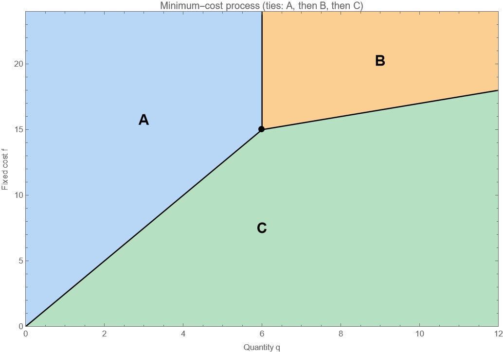

# 示例 01：数量和固定费用如何影响工艺选择

这是一个原创、人工设定的教学算例。目标是练习把成本公式变成可检查的二维区域图，不代表现实企业的校准结果或新的研究发现。

**当前验证状态：已在 Mathematica 13.3.1 中运行基准与练习参数，通过符号、网格和代表点检查，并导出和复核预览图。** Notebook 已隐藏打开并执行全部输入单元；辅助进程退出曾超时，手动可见窗口交互未测试。具体范围见 [VALIDATION.md](VALIDATION.md)。

## 1. 需要什么

适合能阅读一次函数、刚开始使用 AI 辅助科研绘图的学习者。不需要已有 Mathematica 编程经验。

- 一个合法可用的 Wolfram Mathematica 桌面环境；本例已在 Windows 64 位的 13.3.1 中运行，未测试其他版本或操作系统。
- 同目录的 [process_choice.nb](process_choice.nb) 和 [process_choice.wl](process_choice.wl)。前者是操作入口，后者是可阅读、可修改的完整源码；请一起保留。
- 可选：让 AI 阅读[通用绘图技能](../../skills/mathematica-region-plot/SKILL.md)，协助解释或修改代码。跟做本例无需先安装技能。

本例不需要外部数据、第三方程序包、网络调用或其他软件。本项目不提供 Mathematica 安装程序或许可。

## 2. 先把研究问题说清楚

一家企业需要完成数量为 $q$ 的生产任务，可以在 A、B、C 三种工艺中选择一种。这里只比较总成本，三种工艺在整个考察范围内都能完成任务。

| 工艺 | 总成本 | 含义 |
| --- | --- | --- |
| A | $C_A=3q$ | 没有固定费用，单位成本为 3 |
| B | $C_B=12+q$ | 固定费用为 12，单位成本为 1 |
| C | $C_C=f+q/2$ | 固定费用为 $f$，单位成本为 1/2 |

横轴是连续数量 $q\in[0,12]$，纵轴是 C 的固定费用 $f\in[0,24]$。数量可以取非整数，是本例的简化假设。成本使用一致的任意单位。

选择成本最低的工艺。多个工艺成本相同时，依次优先 A、B、C；$q=0$ 也用同一规则。固定费用属于选择该工艺的总成本，在零数量处仍按上表计算。

## 3. 手工判断边界，再让软件绘图

两两成本相等给出三条候选直线：

$$
C_A=C_B\iff q=6,\qquad
C_A=C_C\iff f=5q/2,\qquad
C_B=C_C\iff f=12+q/2.
$$

但相等的两种工艺未必最便宜。例如 $(q,f)=(6,10)$ 时，A 和 B 都花费 18，而 C 只花费 13。所以 $q=6$ 在这里不是最优工艺切换边界。

加入第三种工艺的比较并落实并列顺序后，得到互斥、覆盖整个绘图区的判定：

| 选择 | 条件（均在指定绘图区内） |
| --- | --- |
| A | $q\leq6$ 且 $f\geq5q/2$ |
| B | $q>6$ 且 $f\geq12+q/2$ |
| C | $f<\min\{5q/2,12+q/2\}$ |

三重交点是 $(6,15)$，此时三种成本都为 18，选择 A。图中应强调的边界只有以下三段：

- A/C：从 $(0,0)$ 到 $(6,15)$，边界归 A。
- B/C：从 $(6,15)$ 到 $(12,18)$；除三重交点归 A 外，其余边界归 B。
- A/B：从 $(6,15)$ 到 $(6,24)$，边界归 A。

纵轴 $q=0$ 上全部选 A。横轴 $f=0$ 上，原点选 A，其余点选 C。颜色与线宽无法表现数学上的严格不等式；边界归属应以以上条件和程序判定为准。

## 4. 怎样把任务交给 AI

可以复制以下提示，并附上本例文件或对应公式。重点是给出模型、选择规则和检查标准，而不只是说“帮我画一张漂亮的图”。

```text
请用 Mathematica 的 RegionPlot 和 Show 画出三种生产工艺的最小成本区域。
CA=3q，CB=12+q，CC=f+q/2；q∈[0,12]，f∈[0,24]。
三种工艺全域可行，成本并列时按 A、B、C 顺序选择，q=0 也照此处理。
先给出区域条件和真正改变最优选择的边界，再提供 .wl 源码及 .nb 入口。
用原始成本独立核对代表点、坐标轴、三重交点、边界两侧和适量网格。
图中标明坐标与工艺；颜色可以自行选择。只在本地生成材料。
请分别说明数学检查、Mathematica 实际运行、图像导出哪些已完成。
```

收到结果后先查看区域条件和验证记录，再查看图。若 AI 给出的三条完整直线都被画成最优边界，应要求它比较直线上的第三种工艺成本。

## 5. 在 Mathematica 中运行

1. 保持 `.nb` 和 `.wl` 在同一个文件夹，用 Mathematica 打开 `process_choice.nb`。
2. 点击第一段输入代码，按 **Shift+Enter**。它会通过 notebook 所在目录载入 `.wl`，执行检查并显示图形。源码不会自动导出或覆盖任何文件。
3. 运行 `pcValidation` 单元，检查结果；再运行 `pcSampleResults`，对照代表点。
4. 若出现报错，先保留原文。若约一分钟没有得到结果，用 **Evaluation → Abort Evaluation** 中止，按下节定位原因，不持续重复运行。

基准参数下，实际取得的验证摘要为：

```wolfram
"FixedCostB" -> 12
"TriplePoint" -> {6, 15}
"GridPoints" -> 2401
"GridMismatches" -> 0
"SymbolicRegionChecks" -> {True, True, True}
"SampleChecksPassed" -> True
"TriplePointChoice" -> "A"
"GraphicsConstructed" -> True
```

重新运行时应得到相同摘要。`GraphicsConstructed` 只检查图形对象类型，还需观察图是否正确显示；本例导出图已另行查看。

下图是 Mathematica 实际导出的基准预览。A 在左上方，B 在右上方，C 在下方；三段黑色边界在 $(6,15)$ 汇合。示例颜色可以修改，区域标签便于不依赖颜色辨认工艺。



| $(q,f)$ | $(C_A,C_B,C_C)$ | 应选 |
| --- | --- | --- |
| $(0,0)$ | $(0,12,0)$ | A |
| $(2,10)$ | $(6,14,11)$ | A |
| $(2,1)$ | $(6,14,2)$ | C |
| $(6,10)$ | $(18,18,13)$ | C |
| $(6,15)$ | $(18,18,18)$ | A |
| $(6,20)$ | $(18,18,23)$ | A |
| $(10,24)$ | $(30,22,29)$ | B |
| $(12,18)$ | $(36,24,24)$ | B |

## 6. 常见问题

| 现象 | 优先检查 |
| --- | --- |
| 找不到 `process_choice.wl` | `.nb` 是否已保存，两个文件是否仍在同一目录，文件名是否被改动 |
| 点了运行却只显示符号名 | 是否先运行了第一段载入代码，前面是否已经报错或中止 |
| 空图或区域缺失 | 参数是否有数值，代表点判定是否正确，是否误改了不等号 |
| 边界上结果不同 | 是否改动了 `<` 与 `<=`，是否把精确分数改成了浮点数 |
| 验证失败 | 先查看 `pcValidation` 和 `pcSampleResults`，不要只提高绘图采样数 |
| 内核无法启动 | 先确认 Mathematica 自身能计算 `1+1`；未解决启动或许可问题前，不用修改模型来排错 |

本例用整数和 `1/2` 这样的精确分数处理并列。复杂数值模型可能需要容差，但必须另外说明容差及其对边界的影响。

## 7. 改一个参数，再复核

先复现基准，再把源码开头的 `pcFixedB = 12` 改为 `pcFixedB = 16`，保存并重新运行 notebook 第一段。其余公式和图会使用新值；不要只改标签。

当 B 的固定费用是 $F_B$ 时，A/B 的候选边界变为 $q=F_B/2$，B/C 变为 $f=F_B+q/2$，三重交点变为 $(F_B/2,5F_B/4)$。因此改为 16 后，三重交点应是 $(8,20)$，而 $(6,15)$ 已不再是三重交点。上面的基准代表点表也需要重新计算。

本教学脚本要求 $0<F_B<\min\{2q_{\max},4f_{\max}/5,f_{\max}-q_{\max}/2\}$，在默认坐标范围内即 $0<F_B<18$，目的是让三重交点、边界端点及标签留在图内。它是本例绘图布局的适用限制，不是成本模型的普遍限制。修改单位成本、坐标范围或超出此参数区间时，需要重新推导、裁剪边界并调整标签，不能照搬本图。

运行后再次检查零差异、三项符号检查及交点归属，并手算至少一个发生选择变化的点。例如 $(7,24)$ 在基准下选 B，改为 16 后选 A。完成这一步，才能把“改了参数”与“得到了可信的新图”连接起来。

## 官方函数说明

本例使用 [RegionPlot](https://reference.wolfram.com/language/ref/RegionPlot.html) 定义填色区域，使用 [Show](https://reference.wolfram.com/language/ref/Show.html) 合并区域和线段。入口中的 [NotebookDirectory](https://reference.wolfram.com/language/ref/NotebookDirectory.html) 用于定位已保存 notebook 的目录。批量运行方式可查询 [WolframScript 官方说明](https://reference.wolfram.com/language/ref/program/wolframscript.html)。
